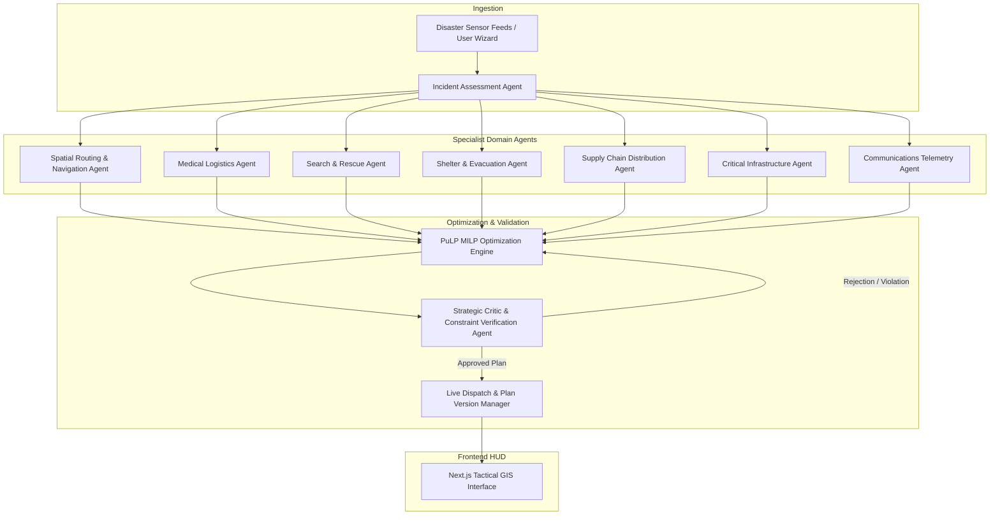

# ARES: Autonomous Disaster Response & Resource Allocation Engine

[](https://fastapi.tiangolo.com)
[](https://nextjs.org/)
[](https://coin-or.github.io/pulp/)
[](https://tailwindcss.com/)
[](https://opensource.org/licenses/MIT)

**ARES** is an autonomous multi-agent disaster response platform designed for real-time triage, spatial navigation, and optimal resource dispatch during large-scale humanitarian emergencies. 

By pairing **collaborative multi-agent reasoning** with **deterministic Mixed-Integer Linear Programming (MILP)** and an **independent Critic Agent**, ARES eliminates AI hallucinations and delivers provably optimal, constraint-safe deployment plans under extreme volatility.

---

## Key Features

- **9 Autonomous Domain Agents**: Coordinated specialist agents managing assessment, spatial routing, medical dispatch, search & rescue, shelter capacities, supply distribution, critical infrastructure, telecommunications, and adversarial criticism.
- **Deterministic Optimization Engine (MILP)**: Uses the PuLP solver to compute mathematically optimal assignments that balance triage severity, transit times, unit capabilities, and remaining hospital bed capacities.
- **Adversarial Critic & Safety Layer**: Audits every proposed plan against strict real-world constraints (fuel limits, blocked route overlaps, curfew restrictions, double-booking) with rollback capabilities.
- **Dynamic "What-If" Simulation Engine**: Injects spontaneous emergency events (flash floods, bridge collapses, grid failures) to test real-time replanning and measure divergence across plan versions.
- **Tactical GIS HUD**: Real-time interactive command center featuring Leaflet satellite overlays, casualty triage markers, flood zone polygons, and animated vehicle trajectory paths.
- **Explainable Decision Traces & Plan Diffs**: Detailed transparency logs exposing agent deliberations, constraint metrics, and atomic plan diffs between revisions.

---

## 9-Agent Architecture



| Agent Name | Primary Responsibility |
| :--- | :--- |
| **Incident Assessment** | Parses telemetry, determines disaster perimeter, triage levels, and priority zones. |
| **Spatial Routing** | Evaluates passable road segments, computes Haversine corridors, and avoids hazards. |
| **Medical Logistics** | Matches patient severity (Red/Yellow/Green) against hospital ICU and bed availability. |
| **Search & Rescue (NDRF/SDRF)** | Coordinates heavy rescue equipment, boat crews, and structural extraction squads. |
| **Shelter & Evacuation** | Directs civilian evacuations to high-ground relief centers and monitors density. |
| **Supply Chain & Rations** | Dispatches drinking water, food packs, and emergency power generator units. |
| **Critical Infrastructure** | Tracks power grid substations, water treatment facilities, and bypass grids. |
| **Communications & Telemetry** | Assesses cellular tower outages, satellite uplinks, and tactical radio relays. |
| **Strategic Critic** | Adversarial safety validator verifying constraint feasibility and zero double-allocations. |

---

## Tech Stack

- **Backend**: Python 3.10+, FastAPI, PuLP (Linear Programming), Pydantic v2, Uvicorn, Pytest
- **Frontend**: Next.js 14 (App Router), TypeScript, Tailwind CSS, Lucide Icons, Leaflet & React-Leaflet
- **GIS / Mapping**: OpenStreetMap, Google Hybrid Satellite Tiles, Turf.js / GeoJSON

---

## Getting Started

### Prerequisites
- Python 3.10 or higher
- Node.js 18+ and `npm`
- Git

---

### 1. Backend Setup

```bash
# Navigate to backend directory
cd backend

# Create and activate virtual environment (optional but recommended)
python -m venv venv
# On Windows:
.\venv\Scripts\activate
# On Linux/macOS:
source venv/bin/activate

# Install dependencies
pip install -r requirements.txt

# Start the FastAPI server
uvicorn app.main:app --reload --port 8000
```

The backend API will be available at `http://localhost:8000`.  
Interactive Swagger documentation is available at `http://localhost:8000/docs`.

---

### 2. Frontend Setup

```bash
# Open a new terminal and navigate to frontend directory
cd frontend

# Install npm dependencies
npm install

# Start the Next.js development server
npm run dev
```

The tactical GIS command interface will be available at `http://localhost:3000`.

---

### 3. Running Unit Tests

```bash
cd backend
pytest
```

---

## Project Structure

```
ares/
├── backend/
│   ├── app/
│   │   ├── agents/          # 9 Autonomous Agent Implementations & Orchestrator
│   │   ├── engine/          # PuLP MILP Solver, Spatial Geometry, Critic Engine
│   │   ├── models/          # Pydantic Schemas & Domain Entities
│   │   ├── scenarios/       # Procedural Scenario & City Preset Generators
│   │   ├── state/           # State Management, History, Plan Version Diffs
│   │   └── main.py          # FastAPI Endpoints & WebSocket Handlers
│   ├── tests/               # Pytest Unit Test Suite
│   └── requirements.txt     # Python Dependencies
├── frontend/
│   ├── src/
│   │   ├── app/             # Next.js 14 App Router (Page, Layout)
│   │   ├── components/      # Tactical Map, Incident Wizard, Diffs, Trace Modals
│   │   └── types/           # TypeScript Definitions
│   ├── package.json
│   ├── tailwind.config.js
│   └── next.config.js
├── .gitignore
└── README.md
```

---

## License

This project is licensed under the MIT License - see the LICENSE file for details.
